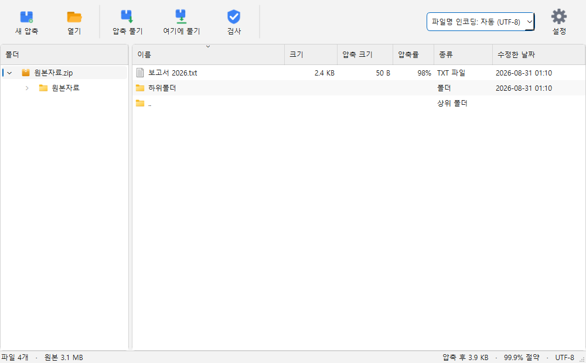
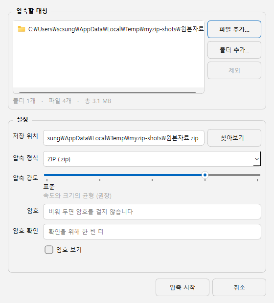
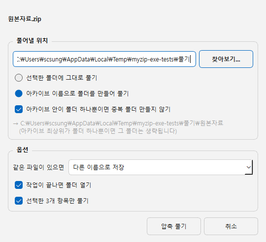
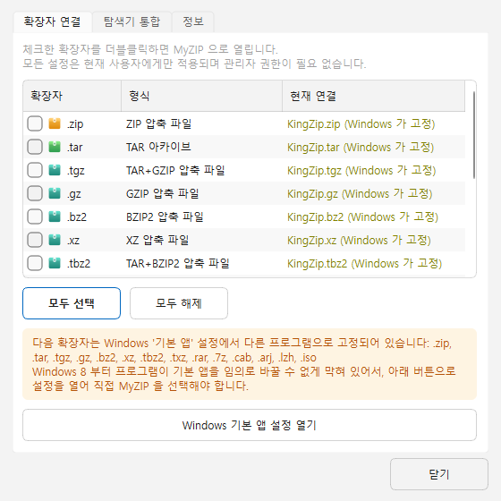
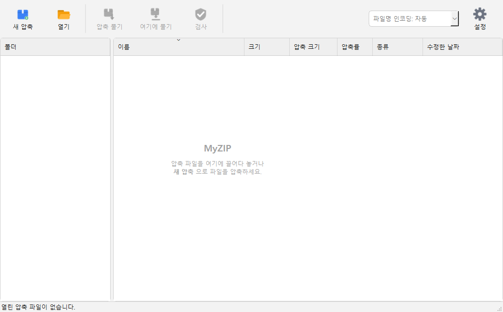

<div align="center">


# MyZIP

**반디집 / KingZip 스타일의 가벼운 Windows 압축 프로그램**

[](https://github.com/saintsc-ai/MyZIP/actions/workflows/tests.yml)
[](LICENSE)
[](https://www.rust-lang.org)

[다운로드](https://github.com/saintsc-ai/MyZIP/releases) ·
[사용법](docs/사용법.md)

</div>

---



## 무엇을 하는가

| 형식 | 압축 | 해제 |
| --- | :---: | :---: |
| ZIP (AES-256 암호) | ✅ | ✅ |
| TAR | ✅ | ✅ |
| TAR.GZ / TGZ | ✅ | ✅ |
| TAR.BZ2 / TAR.XZ | ✅ | ✅ |
| GZ / BZ2 / XZ (단일 파일) | — | ✅ |
| RAR (RAR4 / RAR5) | ❌ | ✅ |
| 7Z, CAB, ARJ, LZH, ISO | ❌ | ✅ |

> **RAR 압축이 없는 이유**: RAR 은 RARLAB 의 독점 형식이고, unRAR 라이선스가
> 그 코드를 RAR 압축기 제작에 쓰는 것을 명시적으로 금지합니다.
> 7-Zip 과 반디집도 같은 이유로 RAR 은 해제만 지원합니다.

## 핵심 기능

- **탐색기 우클릭 메뉴** — 압축하기 / 여기에 압축 풀기 / 폴더 생성 후 풀기 / 무결성 검사.
  기본 연결 프로그램이 MyZIP 이 아니어도 나옵니다.
- **한글 파일명 자동 복원** — UTF-8 / CP949 / CP932 / GBK 를 아카이브 단위로 판별합니다.
  깨져 보이면 툴바에서 직접 고를 수도 있습니다.
- **풀지 않고 들여다보기** — 폴더 트리로 아카이브 안을 돌아다니고,
  파일을 더블클릭하면 임시 폴더로 꺼내 바로 엽니다.
- **경로 탈출 차단** — `../../windows/system32` 같은 악성 경로를 무력화합니다.
- **관리자 권한 불필요** — 레지스트리는 `HKEY_CURRENT_USER` 에만 씁니다.
  제거하면 확장자 연결이 이전 프로그램으로 되돌아갑니다.
- **작고 빠름** — 설치 파일 약 5MB, 실행 파일 하나. 우클릭 메뉴로 띄워도 바로 뜹니다.
- **취소 가능한 진행 표시** — 남은 시간 추정 포함. 취소해도 반쪽짜리 파일이 남지 않습니다.

## 설치

[Releases](https://github.com/saintsc-ai/MyZIP/releases) 에서 받으세요.

| 파일 | 설명 |
| --- | --- |
| `MyZIP-x.y.z-setup.exe` | 설치 마법사. UAC 창 없이 사용자 폴더에 설치됩니다 |
| `MyZIP-x.y.z-portable.zip` | 압축만 풀면 바로 실행. 설치 없음 |

포터블은 탐색기 통합을 쓰려면 한 번만 `MyZIP.exe --register` 를 실행하세요.

> **Windows 11 참고**: 우클릭 메뉴는 **'추가 옵션 표시'**(`Shift`+`F10`) 안에
> 나타납니다. 1차 메뉴에 넣으려면 MSIX 패키지와 서명된 COM 확장이 필요한데,
> 이 프로젝트는 그 복잡도를 택하지 않았습니다.

자세한 사용법은 **[docs/사용법.md](docs/사용법.md)** 를 보세요.

## 화면

<table>
<tr>
<td width="50%"><br><sub>압축하기 — 형식·강도·AES-256 암호</sub></td>
<td width="50%"><br><sub>압축 풀기 — 중복 폴더 방지, 충돌 처리</sub></td>
</tr>
<tr>
<td><br><sub>설정 — 확장자 연결 상태를 함께 표시</sub></td>
<td><br><sub>드래그 앤 드롭으로 열거나 압축</sub></td>
</tr>
</table>

## 소스에서 빌드

MyZIP 은 Rust 로 만듭니다 (1.x 는 Python/PySide6 판이었습니다).
Rust(MSVC 툴체인)와 Visual Studio Build Tools 의 C++ 도구가 필요합니다.

```bash
python tools/fetch_7zip.py         # RAR/7Z 해제 엔진 → bin/ (선택)

cd rust
cargo run --release                # 실행
cargo run --release -- --register  # 확장자 연결 + 우클릭 메뉴 등록
cargo test                         # 테스트
```

## 배포판 만들기

```bash
python build.py --release
```

`release/` 에 설치본, 포터블 ZIP, `SHA256SUMS.txt` 가 만들어집니다.
설치 파일을 만들려면 Inno Setup 6 이 필요합니다:
`winget install JRSoftware.InnoSetup`

| 명령 | 결과 |
| --- | --- |
| `python build.py` | `dist/MyZIP/` 폴더 (MyZIP.exe + 7-Zip 엔진) + 동작 확인 |
| `python build.py --installer` | 위 + 설치 마법사 |
| `python build.py --release` | 처음부터 다시 빌드 + 포터블 + 체크섬 |
| `python build.py --clean` | 산출물 정리 |

빌드 스크립트는 만든 exe 로 압축 → 검사 → 풀기를 한 번 돌려 보고, 포터블 ZIP 도
그 exe 로 묶습니다. 빌드 스크립트는 Python 표준 라이브러리만 씁니다.

`v2.0.0` 같은 태그를 올리면 GitHub Actions(`release.yml`)가 같은 과정을 거쳐
릴리스를 게시합니다. 태그는 `rust/Cargo.toml` 의 버전과 같아야 합니다.

## 구조

```text
rust/
  crates/myzip-core/  포맷 처리 — 화면 의존성 없음
                        ZIP(AES-256), TAR/GZ/BZ2/XZ, 7z.exe 로 RAR·7Z,
                        파일명 인코딩 판별, 경로 탈출 차단
  crates/myzip/       MyZIP.exe
    src/cli.rs          명령줄
    src/instance.rs     단일 인스턴스 (여러 파일 선택을 하나로 모음)
    src/jobs.rs         압축·해제·검사 작업
    src/registry.rs     확장자 연결, 컨텍스트 메뉴 (HKCU)
    src/gui/            egui 화면
    build.rs            아이콘·버전 정보·매니페스트를 exe 에 넣음
resources/icons/      아이콘 원본 (tools/make_icons.py 로 다시 그림, PySide6 필요)
installer/            Inno Setup 스크립트
tools/                7-Zip 받기, 릴리스 게시
```

자세한 내용은 [rust/README.md](rust/README.md) 를 보세요.
## 라이선스

소스 코드는 [MIT](LICENSE).
배포판에 함께 들어가는 Rust 라이브러리와 7-Zip(LGPL + unRAR 제한)에 대해서는
[THIRD-PARTY-NOTICES.md](THIRD-PARTY-NOTICES.md) 를 참고하세요.
